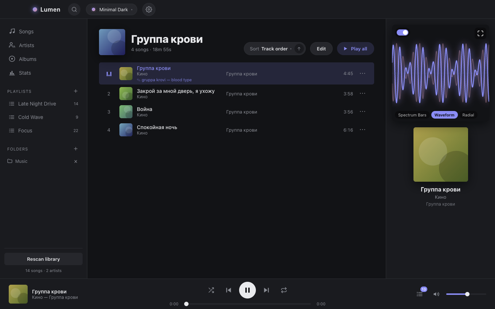
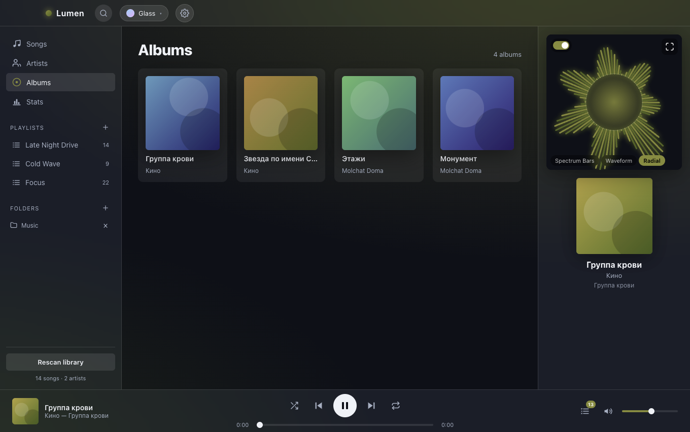
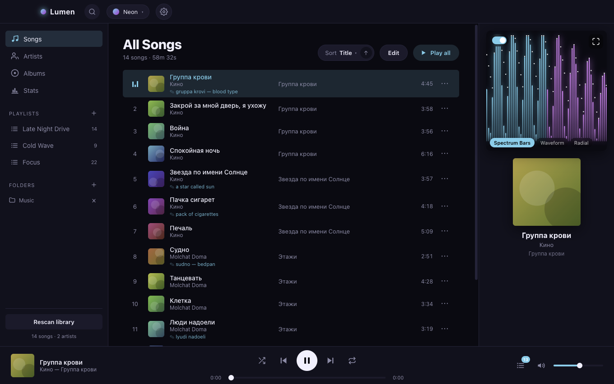

# Lumen 🎧

A music player with reactive visualizers, a proper library, and themes you can make
your own. It's a native app written in Rust: no Electron, no browser engine inside.



<p align="center">
  
  
</p>

📖 **[Full documentation](https://github.com/wumgub/lumen-player/wiki)**: every feature, setting and fix, explained.

There's an Android version too: [lumen-android](https://github.com/wumgub/lumen-android).

## Features

- **Your whole library.** Point it at your music folders and it scans everything:
  MP3, FLAC, WAV/AIFF, M4A/AAC, OGG/Opus, plus MP4/M4V/WebM/MOV **music videos**,
  with their tags and embedded art.
- **Browse** by songs, artists, albums, playlists or folder, with search that
  doesn't care about case or accents, in any alphabet. Songs can have **notes**, and
  search finds those too, so a song with a weird name, or a name in another language,
  is easy to find (right-click → *Add note…*).
- **Fix things without touching your files.** Rename songs, artists and albums, put
  songs on an album (or make a new one), drag an album into your own track order,
  and set album covers. Your edits survive rescans.
- **Music videos** play like any song, with an **Art / Video** switch in Now Playing.
  Double-click the video (or press `f`) and it fills the window.
- **Gapless playback** and nearly any format, through [mpv](https://mpv.io).
- **The queue**: *Play next* / *Add to queue* on any song (or a selection), and a
  queue panel to jump around in and prune.
- **3 visualizers**: Spectrum Bars, Waveform and Radial, synced to what you're
  hearing, with an on/off switch and a frame-rate cap. Dock them in the side panel
  or go full screen (`f`).
- **Themes**: seven built in, including Glass (which blurs the playing song's cover
  behind everything and takes its colours from it), Retro and Blackout. Every colour
  and the font can be customized, and themes import and export as text, shared with
  the Android app.
- **Listening stats**: your most-played songs and the last 12 weeks. Switch it off
  and nothing is saved.
- **Media keys** and your OS's "Now Playing" controls.
- Shuffle (where ⏮ actually goes back to what played), repeat all / one, volume up
  to 150%, and keyboard shortcuts: `Space` play/pause, `⌘←/⌘→` (Ctrl on Windows and
  Linux) previous/next, `f` full screen, `Esc` to leave it.
- **Discord Rich Presence**: optionally show what you're playing, with a live
  progress bar, on your Discord profile.

It's light, too. Compared with the old Electron version it's about a third of the
size to install and uses roughly a quarter of the memory while playing.

## DISCLAIMER!!
This was made using the assistance of AI. However, this is not vibe-coded. AI was used as tool during the making of this, not as a 'code-all' god.

## Discord Rich Presence

Presence is off by default. To turn it on (⚙️ in the top-right → *Discord Rich Presence*):

1. Create an app in the [Discord Developer Portal](https://discord.com/developers/applications) and copy its **Application ID**.
2. Paste that ID into Settings and switch the feature on.
3. Under **Rich Presence → Art Assets**, upload [`build/discord/lumen.png`](./build/discord/lumen.png)
   and name the asset `lumen`. That's the picture shown next to the song.
4. Keep the desktop Discord app running. Lumen updates your status when the song
   changes, you pause, or you seek; the progress bar runs by itself. If Discord quits
   or restarts, Lumen reconnects on its own. If Discord isn't running at all, it just
   waits; nothing breaks.

## Install

### Just want to listen? Download it, no setup needed

**[⬇ Download the latest release](https://github.com/wumgub/lumen-player/releases/latest)**,
grab the one file for your computer, and open it. You can also build from source,
if you're super cool :)

| Your computer | Download this file |
|---|---|
| **Windows** | `Lumen-x.y.z-Setup.exe` |
| **Mac** with Apple silicon (M1 and later) | `Lumen-x.y.z-mac-arm64.dmg` |
| **Mac** with an Intel chip | `Lumen-x.y.z-mac-x64.dmg` |
| **Linux** | `Lumen-x.y.z-linux-x86_64.AppImage` (or `Lumen-x.y.z-linux-amd64.deb`) |

Then open Lumen, click the **＋** next to **Folders** in the left sidebar, choose the
folder your music is in, and it scans and sorts everything for you. Click a song to
play it.

> [!IMPORTANT]
> **The first time you open it, your computer might warn you** that the app is from an
> "unknown"/"unidentified" developer, or try to block it. **This is expected.**
> Lumen is free, open-source software (FOSS) that isn't signed with a paid Apple or
> Microsoft developer certificate. It's safe to open; you just have to tell your
> computer to allow it **once**. Pick your system below for the exact clicks.

<details>
<summary><strong>🪟 Windows easy install </strong></summary>

1. Double-click the downloaded **`Lumen-x.y.z-Setup.exe`**.
2. A blue box may appear: **"Windows protected your PC."** Click the small
   **More info** link, then the **Run anyway** button that appears.
3. The installer opens. Click through it (Next → Install). Lumen then launches and
   adds itself to your Start menu and desktop.

</details>

<details>
<summary><strong>🍎 Mac easy install</strong></summary>

1. Open the downloaded **`.dmg`**, then drag the **Lumen** icon onto the
   **Applications** folder shown next to it.
2. Open **Applications** and double-click **Lumen**. macOS will refuse the first time
   ("Apple could not verify…" / "unidentified developer"). That's the expected
   one-time prompt.
3. Open the Apple menu (top-left of the screen) → **System Settings → Privacy &
   Security**, scroll down to the message about Lumen being blocked, and click
   **Open Anyway** → **Open**. Lumen opens normally every time after this.
   - _Older macOS, or no "Open Anyway" button?_ **Right-click** (or Control-click)
     the **Lumen** app → **Open** → **Open**.
   - _If it says "Lumen is damaged and can't be opened"_ (can happen to downloaded
     unsigned apps on Apple silicon): open **Terminal** (⌘-Space, type "Terminal")
     and run this one line, then open Lumen normally:
     ```bash
     xattr -cr /Applications/Lumen.app
     ```

</details>

<details>
<summary><strong>🐧 Linux easy install (I'm surprised to see you here)</strong></summary>

**AppImage** (works on any distro, nothing to install):

1. Download **`Lumen-x.y.z-linux-x86_64.AppImage`**.
2. Make it runnable: either right-click → **Properties → Permissions → "Allow
   executing file as program"**, or in a terminal:
   ```bash
   chmod +x ~/Downloads/Lumen-*.AppImage
   ```
3. Double-click it (or run `./Lumen-*.AppImage`).
   - If it won't start, you may need FUSE: `sudo apt install libfuse2`
     (Debian/Ubuntu) or `sudo pacman -S fuse2` (Arch).

**Or the `.deb`** (Debian/Ubuntu/Mint): double-click it to install through your
software centre, or `sudo apt install ./Lumen-*.deb`. I also use debian. We are superior.

</details>

### Coming from the Electron version?

Nothing to move. Install the new one over it and your songs, playlists, edits,
covers and listening stats are all there, along with your theme, visualizer and
volume. On Windows and Linux the installer replaces the old version for you; on a
Mac, dragging the new Lumen into Applications does the same.

## Build it yourself

> Only do this if you want to modify Lumen, or there isn't a pre-built download for
> your platform yet. Or if have immeasurable levels of swag.
> If you just want to listen, use the downloads above instead; you don't need
> any of this.

### Prerequisites

- **[Git](https://git-scm.com/)** and **[Rust](https://rustup.rs/)** (stable, 1.95 or
  newer).
- **libmpv**, which does the actual playing:
  - **macOS**: `brew install mpv` (and `brew install dylibbundler` if you want to
    package a `.app`)
  - **Debian / Ubuntu**: `sudo apt install libmpv-dev`
  - **Fedora**: `sudo dnf install mpv-libs-devel`
  - **Windows**: download an mpv dev build (e.g. from
    [shinchiro's builds](https://github.com/shinchiro/mpv-winbuild-cmake/releases),
    the `mpv-dev-x86_64-*.7z` file), and set `MPV_LIB_DIR` to the folder with
    `mpv.lib` / `libmpv-2.dll` in it.

### Run it

```bash
git clone https://github.com/wumgub/lumen-player.git
cd lumen-player
cargo run --release
```

Then click **＋** next to *Folders* in the sidebar, pick your music folder, and it
scans. (The first scan of a big library takes a moment.)

### Package it

```bash
scripts/bundle-macos.sh   # builds target/bundle/Lumen.app with libmpv inside
```

The bundled app carries its own copy of libmpv and everything it needs, so it runs
on a Mac without Homebrew.

### How it's put together

| Part | What it does |
|------|--------------|
| `app` | The app and its interface, drawn with [egui](https://github.com/emilk/egui) on OpenGL. |
| `crates/lumen-core` | The library: the SQLite database, folder scanning ([lofty](https://github.com/Serial-ATA/lofty-rs) for tags), search, stats and themes. |
| `crates/lumen-playback` | Playback through libmpv (audio, and video drawn right into the window), the queue and shuffle rules, and the analyzer the visualizers draw from. |
| `crates/lumen-discord` | Discord Rich Presence over Discord's local socket. |

Lumen used to be an Electron app; that version lives on in the git history (up to
v0.2.5). There's more in the wiki's
[Development guide](https://github.com/wumgub/lumen-player/wiki/Development-guide).

## Troubleshooting

<details>
<summary><strong>A folder scanned but some (or all) tracks are missing</strong></summary>

Lumen only indexes these extensions:
`.mp3 .flac .wav .aif .aiff .m4a .aac .ogg .oga .opus` and the video containers
`.mp4 .m4v .webm .mov`. Anything else (`.wma`, DSD, …) is skipped, as are folders
it doesn't have permission to read. Fix the files or permissions, then click
**Rescan library** at the bottom of the sidebar.

</details>

<details>
<summary><strong>A song shows 0:00 for its length</strong></summary>

Some files just don't say how long they are. The first time one plays, Lumen works
out the real length and remembers it, and rescans won't reset it.

</details>

<details>
<summary><strong>A track is listed but won't play</strong></summary>

The library stores each track's file path. If a file was moved, renamed or deleted
after scanning, it can't be found. Rescan so the library matches what's on disk.

</details>

<details>
<summary><strong>Start the library over from scratch</strong></summary>

The library is a single SQLite file, `library.db`, in your app-data folder:

| OS | Path |
|----|------|
| macOS | `~/Library/Application Support/Lumen/library.db` |
| Linux | `~/.config/Lumen/library.db` |
| Windows | `%APPDATA%\Lumen\library.db` |

Quit Lumen and delete that file for an empty library. This also drops your
playlists, edits and stats.

</details>

<details>
<summary><strong>Discord Rich Presence isn't showing</strong></summary>

- The **desktop** Discord app must be running and signed in on the same machine.
  Presence talks to its local socket, so the browser version won't do.
- In Discord, **Settings → Activity Privacy** must have sharing your detected
  activity enabled, or nothing is shown.
- In Lumen's ⚙️ settings, set the **Application ID** and switch the feature on.
  You often won't see your *own* status on your *own* profile; check from another
  account or the profile pop-out.

</details>

<details>
<summary><strong>The visualizer uses too much CPU</strong></summary>

- **⚙️ → Appearance → Visualizer frame rate**: cap it to **30** or **15 fps**.
- The **switch in the visualizer panel's top-left corner** turns it off entirely.

When nothing's playing it stops redrawing, so the idle cost is close to nothing.

</details>

## License

[GPL-3.0-or-later](./LICENSE) © evanlawrence
