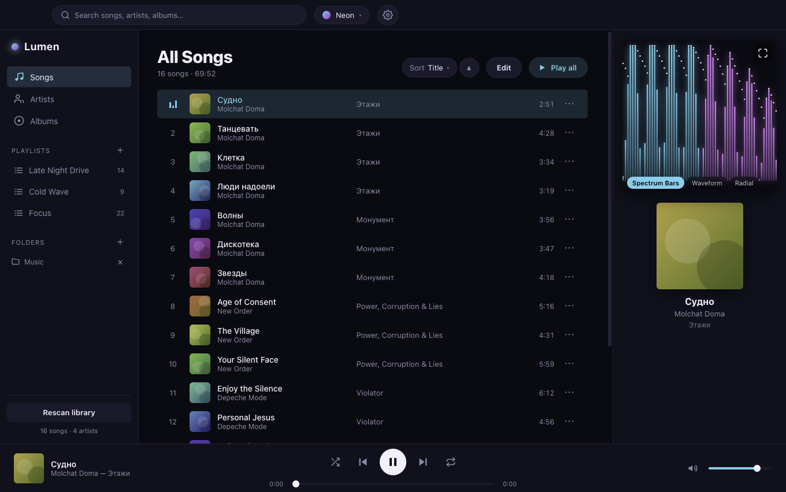
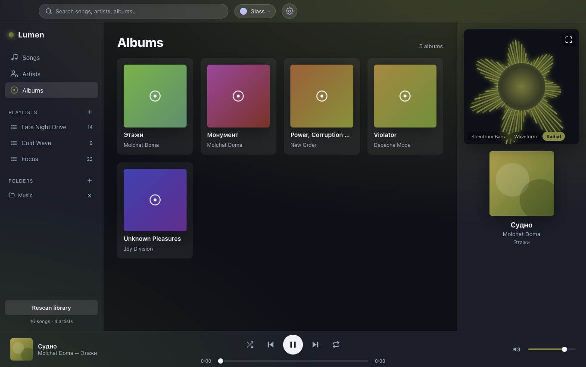
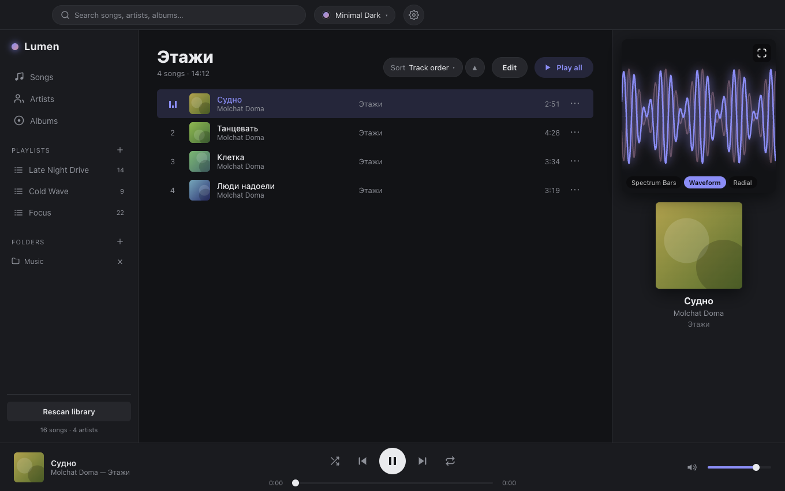

# Lumen 🎧

An Electron music player with reactive audio visualizers, a scanned SQLite library,
and swappable themes.



<p align="center">
  
  
</p>

## Features

- **Full library** — point it at folders, it recursively scans and indexes your media
  (MP3, FLAC, WAV/AIFF, M4A/AAC, OGG/Opus, plus MP4/M4V/WebM/MOV **music videos**)
  into SQLite, reading ID3 tags + embedded art.
- **Browse** by Songs, Artists, Albums, or custom Playlists, with instant search —
  including per-track **notes**, so a song that has a weird name, or a name
  in another language is easy to find directly from search! (right-click → *Add note…*).
- **Music video** — `.mp4` tracks play like any song, with an **Art / Video**
  toggle in Now Playing to show the album art or the video.
- **Queue** — *Play next* / *Add to queue* on any track (or a multi-select), with a
  slide-over queue you can reorder-by-jumping and prune.
- **3 visualizers** — Spectrum Bars, Waveform, and Radial, driven by a Web Audio
  `AnalyserNode`, with an on/off toggle and a frame-rate cap. Toggle between a docked
  panel and an immersive full-window mode (press `f`, or the expand icon).
- **Theme editor** — every colour and the font are customizable; import/export themes
  as text. Plus five built-ins incl. Glass (tints its accents from the album art).
- **Hardware media keys** — ⏯ / ⏭ / ⏮ on your keyboard, and rich OS “Now Playing”
  metadata (title, artist, art, scrubber).
- Shuffle / repeat-all / repeat-one, seeking, volume, and keyboard shortcuts
  (`Space` play/pause, `⌘←/⌘→` prev/next, `f` immersive, `Esc` exit).
- **Discord Rich Presence** — optionally show the current track (with a live
  progress bar) on your Discord profile.

## DISCLAIMER!!
This was made using the assistance of AI. However, this is not vibe-coded. AI was used as tool during the making of this, not as a 'code-all' god.

## Discord Rich Presence

Presence is off by default. To enable it (⚙️ in the top-right → *Discord Rich Presence*):

1. Create an app in the [Discord Developer Portal](https://discord.com/developers/applications) and copy its **Application ID**.
2. Paste that ID into Settings and toggle the feature on.
3. Under **Rich Presence → Art Assets**, upload [`build/discord/lumen.png`](./build/discord/lumen.png)
   and name the asset `lumen` — that's the large cover art shown next to the track.
4. Keep the desktop Discord app running. Presence updates on track and play/pause
   changes (kept well under Discord's rate limit); the progress bar animates from
   start/end timestamps. If Discord isn't running or isn't configured, the app
   simply skips presence — nothing breaks.

## Architecture

| Layer | Responsibility |
|-------|----------------|
| `src/main` | App lifecycle, SQLite library (`better-sqlite3`), recursive scanner (`music-metadata`), native folder picker, and two custom protocols: `lumen-media://` (Range-aware audio streaming) and `lumen-art://` (album art). |
| `src/preload` | Locked-down `contextBridge` API (`window.lumen`). Context isolation on, no Node in the renderer. |
| `src/renderer` | React UI: library views, now-playing, transport, theme engine, and the canvas visualizer host. |
| `src/shared` | Types shared across processes. |

## Install

### Just want to listen? Download it — no setup needed

**[⬇ Download the latest release](https://github.com/wumgub/lumen-player/releases/latest)**,
grab the one file for your computer, and open it. You can also build from source,
if you're super cool :)

| Your computer | Download this file |
|---|---|
| **Windows** | `Lumen-x.y.z-Setup.exe` |
| **Mac** (Apple silicon — M1/M2/M3/M4) | `Lumen-x.y.z-mac-arm64.dmg` |
| **Linux** | `Lumen-x.y.z-linux-x86_64.AppImage` (or the `.deb`) |

> _(The Mac download is for Apple-silicon Macs — any Mac from ~2020 on. On an older
> Intel Mac you'll need to [build it yourself](#build-it-yourself) instead.)_

Then open Lumen, click the **＋** next to **Folders** in the left sidebar, choose the
folder your music is in, and it scans and sorts everything for you. Double-click a
song to play.

> [!IMPORTANT]
> **The first time you open it, your computer might warn you** that the app is from an
> "unknown"/"unidentified" developer, or try to block it. **This is expected** —
> Lumen is free, open-source software (FOSS) that isn't signed with a paid Apple/Microsoft
> developer certificate. It's safe to open; you just have to tell your computer to
> allow it **once**. Pick your system below for the exact clicks.

<details>
<summary><strong>🪟 Windows easy install </strong></summary>

1. Double-click the downloaded **`Lumen-x.y.z-Setup.exe`**.
2. A blue box may appear: **"Windows protected your PC."** Click the small
   **More info** link, then the **Run anyway** button that appears.
3. The installer opens — click through it (Next → Install). Lumen then launches and
   adds itself to your Start menu and desktop.

</details>

<details>
<summary><strong>🍎 Mac easy install</strong></summary>

1. Open the downloaded **`.dmg`**, then drag the **Lumen** icon onto the
   **Applications** folder shown next to it.
2. Open **Applications** and double-click **Lumen**. macOS will refuse the first time
   ("Apple could not verify…" / "unidentified developer") — that's the expected
   one-time prompt.
3. Open the Apple menu (top-left of the screen) → **System Settings → Privacy &
   Security**, scroll down to the
   message about Lumen being blocked, and click **Open Anyway** → **Open**. Lumen
   now opens normally every time after this.
   - _Older macOS, or no "Open Anyway" button?_ **Right-click** (or Control-click)
     the **Lumen** app → **Open** → **Open**.
   - _If it says "Lumen is damaged and can't be opened"_ (can happen to downloaded
     unsigned apps on Apple silicon): open **Terminal** (⌘-Space, type "Terminal")
     and run this one line, then open Lumen normally:
     ```bash
     xattr -cr /Applications/Lumen.app
     ```

</details>

<details>
<summary><strong>🐧 Linux easy install (I'm surprised to see you here)</strong></summary>

**AppImage** (works on any distro, nothing to install):

1. Download **`Lumen-x.y.z-linux-x86_64.AppImage`**.
2. Make it runnable — either right-click → **Properties → Permissions → "Allow
   executing file as program"**, or in a terminal:
   ```bash
   chmod +x ~/Downloads/Lumen-*.AppImage
   ```
3. Double-click it (or run `./Lumen-*.AppImage`).
   - If it won't start, you may need FUSE: `sudo apt install libfuse2`
     (Debian/Ubuntu) or `sudo pacman -S fuse2` (Arch).

**Or the `.deb`** (Debian/Ubuntu/Mint): double-click it to install through your
software centre, or `sudo apt install ./Lumen-*.deb`. I also use debian. We are superior.

</details>

## Build it yourself

> Only do this if you want to modify Lumen, or there isn't a pre-built download for
> your platform yet. Or if have immeasurable levels of swag.
>  If you just want to listen, use the downloads above instead,> you don't need
>  any of this.

### Prerequisites

- **[Git](https://git-scm.com/)** and **[Node.js](https://nodejs.org/) 18 or newer** —
  **20 LTS is recommended**, because it matches the Node ABI that Electron 33 bundles
  and avoids the rebuild workaround below. `npm` comes with Node. Check with
  `node -v` and `npm -v`.
- A **C/C++ build toolchain.** The library index uses `better-sqlite3`, a native
  module that is compiled against Electron when you install, so a compiler must be
  present on every platform:
  - **macOS** — Xcode Command Line Tools: `xcode-select --install`
  - **Debian / Ubuntu** — `sudo apt install build-essential python3` (and, to *run*
    the app on a minimal install, the usual desktop libs: `libgtk-3-0 libnss3 libasound2`)
  - **Windows** — the *“Desktop development with C++”* workload from the
    [Visual Studio Build Tools](https://visualstudio.microsoft.com/visual-cpp-build-tools/)

### 1. Clone the repo

```bash
git clone https://github.com/wumgub/lumen-player.git
cd lumen-player
```

### 2. Install dependencies

On an LTS Node this is all you need — the `postinstall` step rebuilds
`better-sqlite3` against Electron's ABI for you:

```bash
npm install
```

<details>
<summary><strong>Install fails on a newer-than-LTS Node (e.g. 22+), or you see an ABI / <code>NODE_MODULE_VERSION</code> / "Electron uninstall" error → expand</strong></summary>

A Node that's newer than Electron's bundled runtime ships an ABI that
`better-sqlite3`'s prebuilt binary doesn't cover, and Electron's own installer can
mis-extract its binary. Install in two steps instead:

```bash
# Install JS deps WITHOUT the native build scripts (they'd target the wrong ABI)
npm install --ignore-scripts

# Compile the native module (better-sqlite3) against Electron's ABI
npm run rebuild
```

If `npm run dev` then still complains **"Electron uninstall"**, the Electron binary
didn't extract. Pull it from the download cache by hand. Match the version
(**33.4.11**, or whatever `npx electron --version` prints), your **platform**
(`darwin` macOS / `linux` / `win32`) and **arch** (`arm64` Apple silicon / `x64`):

```bash
# Where the cache lives:
#   macOS    ~/Library/Caches/electron
#   Linux    ~/.cache/electron
#   Windows  %LOCALAPPDATA%\electron\Cache

# Example — macOS, Apple silicon:
unzip -q ~/Library/Caches/electron/*/electron-v33.4.11-darwin-arm64.zip -d node_modules/electron/dist
printf 'Electron.app/Contents/MacOS/Electron' > node_modules/electron/path.txt
```

The `path.txt` contents differ per platform: `Electron.app/Contents/MacOS/Electron`
on macOS, `electron` on Linux, `electron.exe` on Windows.

</details>

### 3. Run it

```bash
npm run dev          # launch in dev mode with hot reload
```

Then click **＋** next to *Folders* in the sidebar, pick your music directory, and it
scans. Double-click any track to play. (First launch indexes your library; large
collections take a moment.)

### Build & package installers

```bash
npm run build        # bundle main/preload/renderer into out/
npm run pack:mac     # package a .dmg + .zip      (macOS)   → dist/
npm run pack:win     # package a Setup.exe        (Windows) → dist/
npm run pack:linux   # package an AppImage + .deb (Linux)   → dist/
```

`electron-builder` can only package for the OS you run it on, so build the macOS
artifacts on macOS, Windows on Windows, and Linux on Linux.

### Cutting a release

The downloads for every platform are built automatically by GitHub Actions
([`.github/workflows/release.yml`](.github/workflows/release.yml)). Push a version
tag and it builds the macOS, Windows and Linux installers and attaches them to a new
GitHub Release:

```bash
npm version patch         # bumps package.json and creates the matching git tag
git push --follow-tags    # pushing the tag starts the build + publish
```

A few minutes later the files appear on the
[Releases page](https://github.com/wumgub/lumen-player/releases/latest) for everyone
to download. (The apps are unsigned — see the one-time "unknown developer" note under
[Install](#install).)

## Troubleshooting

<details>
<summary><strong>A folder scanned but some (or all) tracks are missing</strong></summary>

Lumen only indexes these extensions:
`.mp3 .flac .wav .aif .aiff .m4a .aac .ogg .oga .opus` and the video containers
`.mp4 .m4v .webm .mov`. Anything else (`.wma`, DSD, …) is skipped, as are folders
it doesn't have permission to read. Fix the files/permissions, then click
**Rescan library** at the bottom of the sidebar.

</details>

<details>
<summary><strong>A track is listed but plays silence</strong></summary>

The library stores each track's file path. If a file was moved, renamed, or
deleted after scanning, streaming it fails and you get silence. Re-scan the
folder so the index matches what's on disk. (In dev, the terminal / DevTools
console shows a `404` on a `lumen-media://` request when this happens.)

</details>

<details>
<summary><strong>Start the library over from scratch</strong></summary>

The index is a single SQLite file, `library.db`, in Electron's per-user
app-data folder:

| OS | Path |
|----|------|
| macOS | `~/Library/Application Support/<app>/library.db` |
| Linux | `~/.config/<app>/library.db` |
| Windows | `%APPDATA%\<app>\library.db` |

Quit Lumen and delete that file for an empty library. `<app>` is the app's name
(`lumen-player` when run from source).

</details>

<details>
<summary><strong>Discord Rich Presence isn't showing</strong></summary>

- The **desktop** Discord app must be running and signed in on the same machine
  — presence talks to its local socket, so the browser version won't do.
- In Discord, **Settings → Activity Privacy** must have sharing your detected
  activity enabled, or nothing is shown.
- In Lumen's ⚙️ settings, set the **Application ID** and toggle the feature on.
  Note you often won't see your *own* status on your *own* profile — check from
  another account or the profile pop-out.
- **Per-track album art** additionally needs the Client Secret and a one-time
  **Authorize** prompt (see [Discord Rich Presence](#discord-rich-presence)
  above). If authorization fails it quietly falls back to the `lumen` logo/text
  and logs `[presence] …` lines in the terminal.

</details>

<details>
<summary><strong>The visualizer uses too much CPU</strong></summary>

It draws to a canvas while a track plays. To lighten or stop it:

- **⚙️ → Appearance → Visualizer frame rate** — cap it to **30** or **15 fps**.
- The **toggle in the visualizer panel's top-left corner** turns it off
  entirely, which stops the render loop.

It already auto-throttles itself when playback is paused or the window is
hidden, so the idle cost is low.

</details>

<details>
<summary><strong><code>npm run dev</code> opens a blank window</strong></summary>

Most often the native module failed to load — look for a `better-sqlite3` /
`NODE_MODULE_VERSION` error in the terminal and re-run the
[two-step install](#2-install-dependencies). Opening DevTools
(<kbd>⌘⌥I</kbd> on macOS, <kbd>Ctrl+Shift+I</kbd> elsewhere) surfaces any
renderer-side errors.

</details>

## License

[GPL-3.0-or-later](./LICENSE) © evanlawrence
